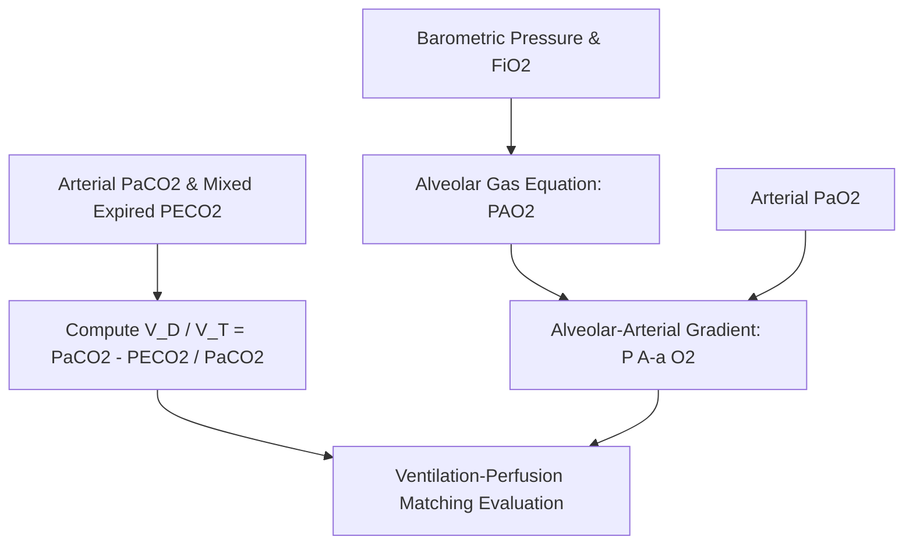

# Pulmonary Alveolar Dead Space (Bohr-Enghoff) Skill

[](LICENSE)
[](https://www.python.org/)
[](https://openclaw.org/)
[](https://alphapark.ai/)
[](https://modelcontextprotocol.io/)

Physiological Alveolar Dead Space Fraction ($V_D / V_T$) and Alveolar Gas Exchange Calculator based on the Bohr-Enghoff formulation.



## Features
- **Zero PIP Dependencies**: Implemented strictly with Python Standard Library (`math`, `json`, `sys`, `typing`).
- **Standard Bohr-Enghoff Formula**: Resolves arterial-to-expired carbon dioxide gradient into non-perfused alveolar fraction.
- **Alveolar Gas Equation**: Age-adjusted physiological shunt and diffusion gradient analysis.
- **Dual Architecture**: Native Python import and Model Context Protocol (MCP) JSON-RPC 2.0 stdio server.

## Quickstart
```bash
python example_usage.py
```

## License
Apache-2.0
